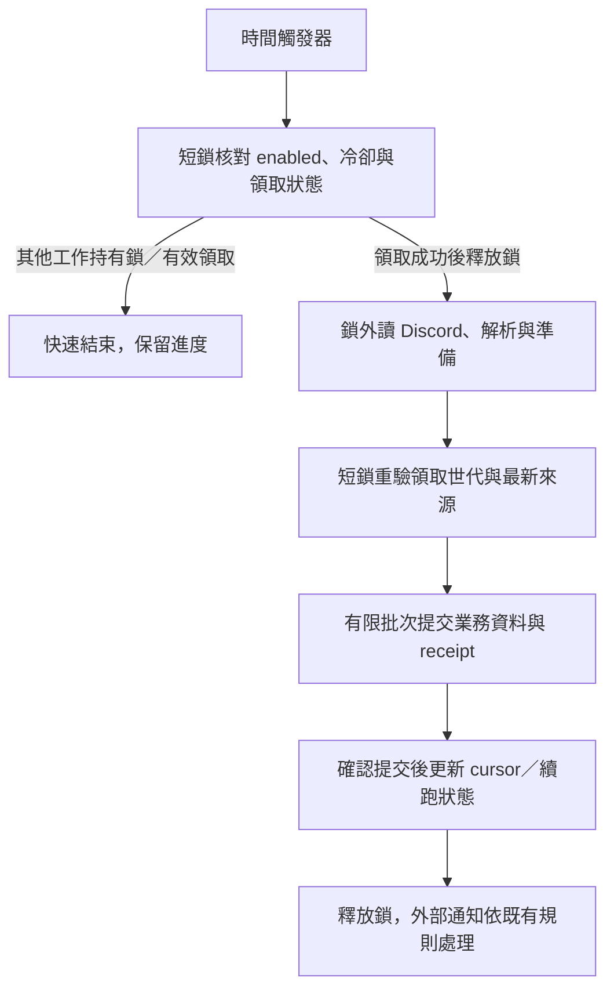

# Discord／GAS 輪詢架構審查

審查日期：2026/10/29。專案基準：main `5412041`。

審查來源：使用者提供的 `discord-gas-polling-architecture.md`，以及本專案 GAS 後端、儲存協議與打包流程。附件內的實作指令僅作待審規格；這次只審查，沒有實作 Poller、安裝排程、設定憑證或連線正式 Discord／GAS。

## 判斷

**單一、低流量頻道，容許分鐘級延遲時可行；原規格不能原樣接進目前專案。** 主要風險是長時間占用請假使用的同一把鎖、空內容被誤判而丟掉連結、跨輪分頁沒有落實，以及尚未定義真正的業務處理／防重複交易。

不需要新增常駐 Node 或 WebSocket；同 GAS 專案直接呼叫內部服務可省掉自打 `/exec` 的往返。但「同專案」不代表可繞過現有業務驗證，也不代表背景工作能長時間占用 Script Lock。以下修正均為建議，尚未套用。

## 依影響排列的發現

### P1：整輪持有 Script Lock，會讓請假寫入重新遇到忙碌

附件 §6.2 第一步取得 Script Lock，直到抓訊息、分頁、處理所有 URL 完才釋放。Google 的 Script Lock 以整個 script 為範圍，不會因為函式不同而分成兩把。[LockService 官方說明](https://developers.google.com/apps-script/reference/lock/lock-service#getScriptLock())

本專案 [backend.js](gas/src/backend.js) 的 `locked()`（152 行）也是這把鎖，`submitParticipation` 等寫入在此保護下執行，最多等 10 秒後回 BUSY。當 Poller 的 Discord HTTP／URL handler 變慢，請假送出就要一起等；唯讀白名單仍可讀，不能因此判定沒有使用者影響。

隔離模擬目前後端的結果：

| 狀態 | 行事曆 | 請假表單 | 請假送出 |
| --- | --- | --- | --- |
| 模擬 Poller 占住 Script Lock | 成功 | 成功 | BUSY |
| 釋放後，以同份請假草稿送出 | — | — | 成功 |

修正方向：短鎖領取工作、鎖外讀 Discord／解析、短鎖核對並提交。不能改用 User Lock 就當作獨立鎖；若背景與 Web App 都由部署者身分執行，仍可能互相競爭。Standalone／Web App 的 Document Lock 也不能作為通用替代。[LockService 範圍](https://developers.google.com/apps-script/reference/lock/lock-service)

### P1：HTTP 成功或 content 為空，不代表有權讀到完整訊息

附件要求 401／403 報錯，這部分正確；但還漏兩種會靜默丟資料的情況：

- 缺 `READ_MESSAGE_HISTORY` 時，讀訊息端點可以回空陣列；不能把它直接認定為空頻道並完成初始化。
- 未取得 `MESSAGE_CONTENT` 存取時，一般訊息的 `content` 可以是空字串。若依 §6.2「空內容直接前進 cursor」，恢復權限後也不會重新掃到那些連結。REST 同樣受這個 intent 影響，不因沒連 Gateway 就免除。

這是官方明確列出的行為。[讀取頻道訊息](https://docs.discord.com/developers/resources/message#get-channel-messages)、[Message Content 與 HTTP 限制](https://docs.discord.com/developers/events/gateway#message-content-intent)

初始化應驗證頻道有效權限與 intent 設定，並用受控的一般使用者測試訊息確認可讀正文，再啟用。不可把「曾讀到一則內容」當作永久健康證明：Bot 自己的訊息或被提及的訊息可能適用例外。運行期間補上設定／權限健康檢查、異常空內容監測與暫停恢復方式；觀測異常不能冒充百分之百辨識權限變更。

另外，真正的空頻道也要保存 `initialized` 狀態；下一輪不能因 cursor 未設就再次跳到最新訊息，否則第一批新訊息可能被當成初始化而略過。狀態須綁 channelId，換頻道不可沿用舊 cursor。

### P1：只提醒分頁風險，還不足以確保跨輪不漏訊息

附件 §5 已正確提醒不能假設 `after` 一定挑出最舊的待處理 100 則。官方列出新到舊的回傳順序、單次上限 100，且 before／after／around 互斥；這些資訊仍不足以證明附件希望使用的遞增窗口策略。[訊息分頁合約](https://docs.discord.com/developers/resources/message#get-channel-messages)

例如 cursor 後有 700 則，單輪上限五頁：

- 若只處理拿到的最新 500 則，再把 cursor 推到最新，可能越過未處理的舊訊息。
- 若五頁後不保存掃描進度、下輪又從最新開始，即使不前進 cursor，也可能永遠掃不到最舊邊界。

可採保守方案：固定本批上界 U，以 before 向舊掃描，將必要資料與掃描邊界持久化；證明已涵蓋 `(C, U]` 後，才由舊到新交付。超過頁數／時間上限時，保存同一窗口的續跑狀態，下輪接續，不能重開窗口；新於 U 的訊息留給下一批。

此方案需要持久化待處理資料，不只是四個 Properties。若未選定暫存方式與完成邊界，就不能宣稱已滿足「超過 100 則不漏訊息」。輪詢前已刪除的訊息本來就讀不到；REST 輪詢也不是原子快照，不能保證擷取所有曾經存在的訊息。

### P1：handler 的成功與防重複必須落到業務交易

附件的 at-least-once 判斷正確。但 §7 的 TODO／console.log handler 沒有業務效果，若當作成功並前進 cursor，之後補上正式 handler 也不會再處理那些訊息。

本專案已用 [common.js](gas/src/common.js) 的 `retry()` 與 [storage.js](gas/src/storage.js) 的提交標記，將業務資料和 requestId 結果一起提交。新 adapter 應重用同等保護：

1. 穩定來源識別由 channelId／messageId／原文 URL occurrence index 組成。
2. 來源識別和業務場次 ID 分開命名，例如 `sourceEventId` 與 `battleEventId`；附件的 eventId 不能直接當成我們的活動 ID。
3. 通用 requestId 只接受 1–64 位英數字、底線、連字號，附件的冒號格式不能直接套入該 helper。可用帶命名空間的穩定雜湊作 requestId，另保存來源識別；不同既有端點的 validator 也要逐一核對。
4. 業務變更與成功 receipt 在同一受保護交易提交。Property cursor 只能在確認提交後前進；若提交後 cursor 寫入失敗，下輪由 receipt 辨識已完成，不再次產生業務資料。
5. 新程式若呼叫現有 `GuildGas.rpc()`，須檢查 `{ ok }`；RPC 會把例外轉成錯誤物件，並非一定往外 throw。不能以「沒有拋例外」判定成功。

Sheets receipt 可以保護站內寫入；若 handler 還有外部副作用，必須另定其冪等或復原協議，不能承諾跨服務 exactly-once。永久失敗訊息依附件規則會擋住後續訊息，至少要能看見停住原因並人工修復／明確處置，不可偷偷跳過。

### P1：同專案的全域函式不能直接變成匿名可呼叫的管理入口

附件列出 setupDiscordPolling／pollDiscordChannel／handleDiscordUrl 等一般全域函式，但本專案 Web App 允許匿名開啟。若直接新增無驗權的頂層 `.gs` 函式，即使前端沒有按鈕，HTML Service 使用者也可能透過 google.script.run 呼叫；原本 RPC 內的登入／CSRF 檢查不會自動保護這些新入口。[HTML Service 私有函式規則](https://developers.google.com/apps-script/guides/html/communication#private_functions)

排程／初始化／停止入口應隱藏於前端不可呼叫的私有函式邊界，例如尾綴底線的 wrapper；編輯器用操作再沿既有 `requireGasExecutor_()` 等操作者驗證。若要提供網頁上的管理功能，另走明確的 admin RPC 與 CSRF，不能公開任意 payload 的可信 handler。輪詢器內部呼叫也不應被誤當作登入／授權已完成。

### P2：每天 HTTP 次數可能足夠，觸發器執行時間更容易先碰限額

官方目前列出的帳號配額如下，會變動，且以使用者計算；同一帳號拆成兩個 GAS 專案也不等於多一份配額。[GAS 官方配額](https://developers.google.com/apps-script/guides/services/quotas)

| 項目 | 個人帳號 | Workspace |
| --- | --- | --- |
| 觸發器每日總執行時間 | 90 分鐘 | 6 小時 |
| URL Fetch 每日次數 | 20,000 | 100,000 |
| 每次一般 script 執行上限 | 6 分鐘 | 6 分鐘 |
| Properties 單值／整個 store | 9 KB／500 KB | 9 KB／500 KB |

以名義上每分鐘一次、每天約 1,440 輪推算：個人帳號平均每輪只剩 **3.75 秒**，Workspace 為 15 秒，還沒扣其他觸發器。假設每輪平均耗時 2／3／5 秒，每日約為 48／72／120 分鐘；這是規劃計算，不是本案 Google 實測。

建議先量無新訊息、一般訊息、有 URL、分頁追趕四種耗時，另記 Discord fetch、寫入等待與提交時間。沒有 URL 時只讀 Poller 設定／進度，不開試算表、不讀登入狀態或全名冊；有工作才進業務流程。不能每個 URL 都重新開表、掃整份 commits／名冊或讀整頁資料。

若一分鐘頻率不符合實測預算，五分鐘約每天 288 輪，可增加每輪預算，但延遲也提高；這是待選方案，不擅自修改使用者的一分鐘需求。排程間隔與日額度都是限制，不能把「單次未超過六分鐘」視為整天可持續運作。

429 必須保存 `nextAllowedAt`，依 Retry-After／retry_after 決定下次最早請求時間；若要求等 20 分鐘，下個一分鐘 trigger 也必須略過。不要用長時間 sleep 占住執行或業務鎖。401／403 等設定錯誤宜暫停並顯示原因，避免持續無效請求。[Discord rate limits](https://docs.discord.com/developers/topics/rate-limits)

### P2：現有打包、排程身分和啟用流程需要另外接線

- [package-gas.js](tools/package-gas.js) 只從 backend.js 編譯 Backend.gs，複製 Code.gs／manifest；[gas-sync.js](tools/gas-sync.js) 核對固定四檔。直接新增附件所列的六份 `.gs` 不會自動進同步包。建議沿 `gas/src/discord-*.js` 加模組，Code.gs 放必要入口；確有新增檔案才另改打包與讀回比對契約。
- [appsscript.json](gas/appsscript.json) 已有 external_request，尚無程式建立／移除 trigger 所需的 `script.scriptapp` scope；採附件 setup 功能時須補權限並由操作者完成授權，不能靠排程跳出授權畫面。[ScriptApp 授權要求](https://developers.google.com/apps-script/reference/script/script-app#newTrigger(String))
- `getProjectTriggers()` 只列目前使用者的 trigger，不能保證其他帳號沒裝。應指定單一安裝者，保存已登記 trigger／owner 資訊並做執行去重；不能只憑當前清單就宣稱全專案唯一。觸發器以建立者身分執行，配額也要以該帳號評估。[安裝式觸發器限制](https://developers.google.com/apps-script/guides/triggers/installable)
- 一般 trigger 直接按 handler 呼叫專案函式，不能把目前 Web App 的固定部署版本當成 Poller 啟用閘門。Google 對目前程式碼與版本部署有明確區分；此處依 trigger 入口與部署合約推導，未在正式專案驗證。應有預設關閉的獨立 enabled 開關、相容的資料協議及獨立啟停／回復步驟，未更新 Web App 不代表背景排程不會工作。[部署版本說明](https://developers.google.com/apps-script/concepts/deployments)、[Trigger 入口合約](https://developers.google.com/apps-script/reference/script/script-app#newTrigger(String))

## 適合目前專案的整合方式

優先考慮同專案的「短鎖領取＋鎖外抓取＋短鎖提交」，省去另一個 Web App 呼叫，但需新增可驗證的工作領取狀態。以下是設計方向，不是已實作協議。

| 工作 | 是否持有業務 Script Lock | 邊界 |
| --- | --- | --- |
| 領取／續租／更新小型 Poller 狀態 | 短暫持有 | 短等待，拿不到就讓出；不是排隊十秒 |
| Discord HTTP、分頁抓取、URL 解析 | 不持有 | 保存冷卻／時間與頁數預算，不 sleep |
| Sheets 暫存或業務／requests／commits 寫入 | 必須在既有提交保護下 | 有限批次；不能因表名不同自行解鎖 |
| 更新已確認提交的 cursor | 短暫持有 | 核對世代，保持單調前進 |
| 通知與慢外部操作 | 不持有 | 避免讓請假一起等待，副作用另定冪等 |

領取狀態不是單一 `running=true`：執行被中止後不能永遠卡死。需租約期限、owner／generation，舊執行恢復後每次落地都要檢查是否仍持有該世代；新執行不能被舊執行的 finally 清掉。租約、停用、換頻道和續跑資料須一起設計，不可用 CacheService 當唯一正確性依據。

不能把外層鎖包住現有會自行取鎖／釋放鎖的 RPC；應建立清楚的內部交易入口，鎖的取得與釋放由單一層擁有。最終寫入仍會和請假短暫序列化，不能保證完全零等待；重點是排除網路及不必要的批次工作，控制並量測鎖內耗時。

若獨立另一個 GAS 專案，Poller 的 Script Lock 可和網站隔離，但對同一份 GuildManager Sheets 的業務寫入仍必須回到受保護入口，不能兩個專案各拿自己的鎖直接追加共用 commits。這還會新增 HTTP 認證、傳輸結果不明與重試問題，同帳號配額也未必隔離；不宜只為避鎖就直接採用。

## 還需要確定的業務範圍

目前沒有 `handleDiscordUrl` 服務，任意 URL 也沒有足夠欄位可直接變成我們的影片或戰績。例如 [videos.js](gas/src/videos.js) 的提交需場次及版本、名稱、團別、職業等資訊，Discord authorId 並不是遊戲 UID。

實作前需要明確選定：

- URL 要進待審清單、影片，還是其他功能？缺少場次／人物／職業時如何處理？
- 允許哪些來源網站、作者／身分組，是否處理 Bot／Webhook 訊息？避免自動通知再被掃入形成循環。
- URL 相同但不同訊息、同訊息重複網址，業務要視為同一筆還是多筆？URL index 應在業務過濾前固定，解析規則改版也要保留已有事件的識別。
- 永久失敗如何通知管理者、修復或經明確操作處置？不能把未處理靜默視為成功。

Google 帳號授權不等於本網站的 admin session。排程不應保存瀏覽器 session、硬塞 admin context 或公開一個略過 CSRF 的任意 handler；內部入口要有固定能力、來源設定與同等資料驗證。既有向外發送通知的 Discord Webhook 也不能代替讀取頻道所需的 Bot Token。

原文保留 URL、不自動下載任意網址的方向可保留。若日後需要抓網頁，另訂允許協定／主機與重新導向驗證。URL 尾端清理不可直接刪掉所有括號／句點，合法路徑或參數也可能含這些字元。

## 實作前驗收應再補的情境

附件的驗收可保留，另補：

1. Discord HTTP 尚未回應時，網站請假仍可成功提交；業務短鎖競爭才允許有限等待，沒有長網路鎖。
2. 執行被中止／租約過期／舊執行晚回來，不重複提交、退回 cursor 或清掉新領取。
3. 101、500、701 則以及持續新訊息，跨多輪仍依固定窗口續跑；不只測一輪反轉陣列。
4. 空頻道首批訊息、重跑 setup、換頻道、缺歷史權限回空陣列、缺 intent 回空內容，都不靜默丟資料。
5. 第二個 URL 失敗、業務提交後 cursor 寫入失敗、RPC 回 ok=false，安全重試且不誤判成功。
6. 429 的等待長於一分鐘、401／403、5xx、畸形 JSON、網路逾時，不狂重試或越過失敗訊息。
7. 空輪詢不讀 Sheets／名冊／登入狀態；記錄實際執行、持鎖、批次與日累積成本，觀察是否持續追得上。
8. 多帳號重複安裝、預設停用、停用保留 cursor、程式同步但不更新 Web App，啟用行為可預測。
9. 匿名／member 無法透過 google.script.run 建立／移除 trigger、重設 cursor 或直接提交可信 handler。

## 本次驗證與限制

已查核官方文件及本機來源；使用既有 gasRuntime 在記憶體編譯後載入隔離 GAS 模擬，重現同 Script Lock 對讀／寫的差別。腳本 `/private/tmp/guild-discord-polling-review-check.mjs`，結果 `/private/tmp/guild-discord-polling-review-check.json`。測試未讀取私有帳密或真實頻道，使用獨立 fixture，沒有對外發送通知。

沒有可執行的 Poller，因此未驗證真實 Discord after 的選窗行為、正式網路耗時、Google 觸發器排程或日配額；分頁、租約與短鎖是待實作方案，不宣稱已通過端到端驗證。只新增本審查文件，產品程式、manifest、AGENTS 現行規則及 release note 不改，不升版、不同步 GAS 或更新部署。
